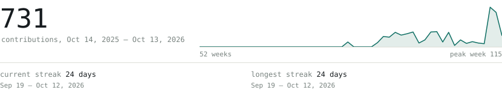
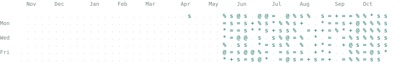
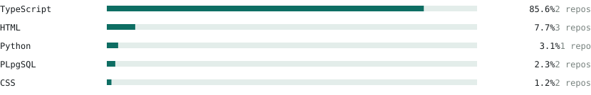

<picture>
  <source media="(prefers-color-scheme: dark)" srcset="assets/portrait-dark.svg">
  
</picture>

<picture>
  <source media="(prefers-color-scheme: dark)" srcset="assets/hd-projects-dark.svg">
  
</picture>

**Stealth Startup** 
Currently building in GovTech. Feel free to reach out :) 
<samp>govtech · in stealth</samp>

**Stealth Startup** 
Partnered with the White House to bring local government information to the public. 
<samp>govtech · past</samp>

**[Patchr](https://github.com/arshsparekh/Patchr-Fixing-New-Jersey-s-Roads)** 
A tool that streamlines road & facility issues and New Jersey's government response. 
<samp>typescript · postgres</samp>

**[HoagieFunctions](https://github.com/arshsparekh/hoagiefunctions)** 
A prototype for a new social-scene website at Princeton. 
<samp>typescript · postgres</samp>

<picture>
  <source media="(prefers-color-scheme: dark)" srcset="assets/hd-activity-dark.svg">
  
</picture>

<picture>
  <source media="(prefers-color-scheme: dark)" srcset="assets/stats-dark.svg">
  
</picture>

<picture>
  <source media="(prefers-color-scheme: dark)" srcset="assets/year-dark.svg">
  
</picture>

<picture>
  <source media="(prefers-color-scheme: dark)" srcset="assets/langs-dark.svg">
  
</picture>

Every graphic here is drawn by this repository. A nightly action redraws the activity from the GitHub API.
